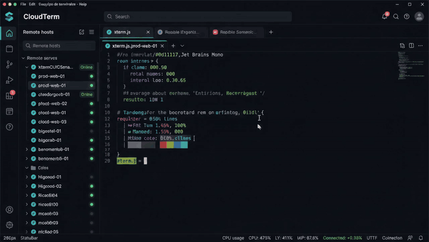
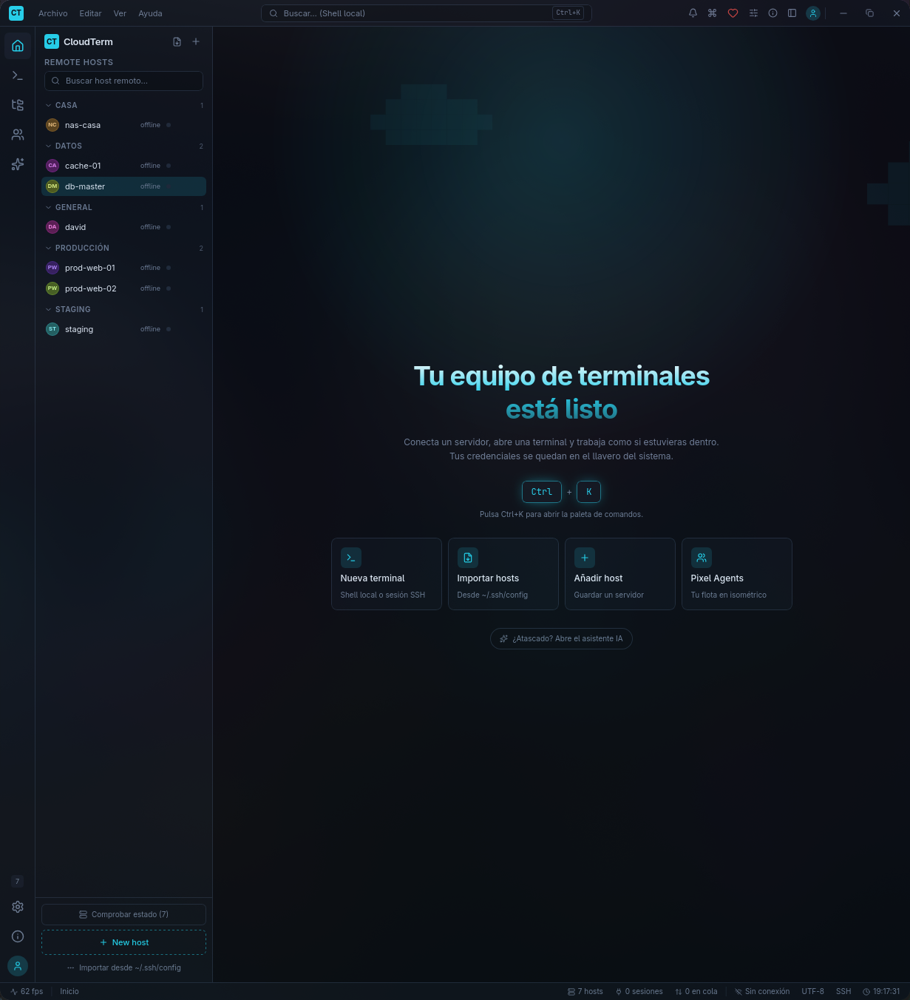
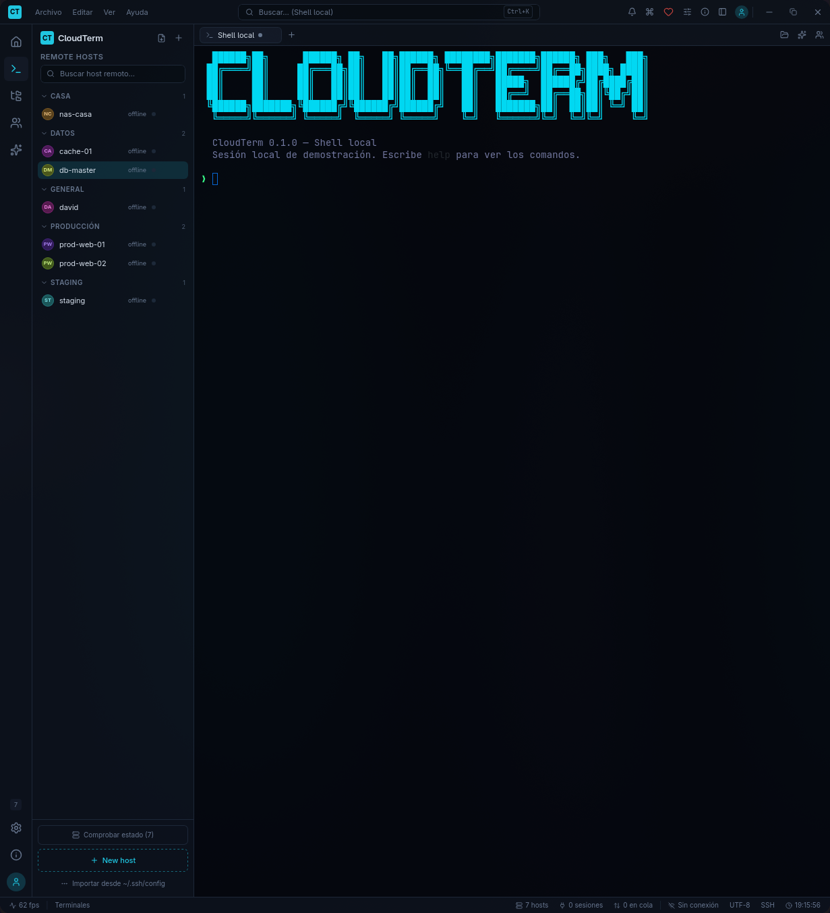
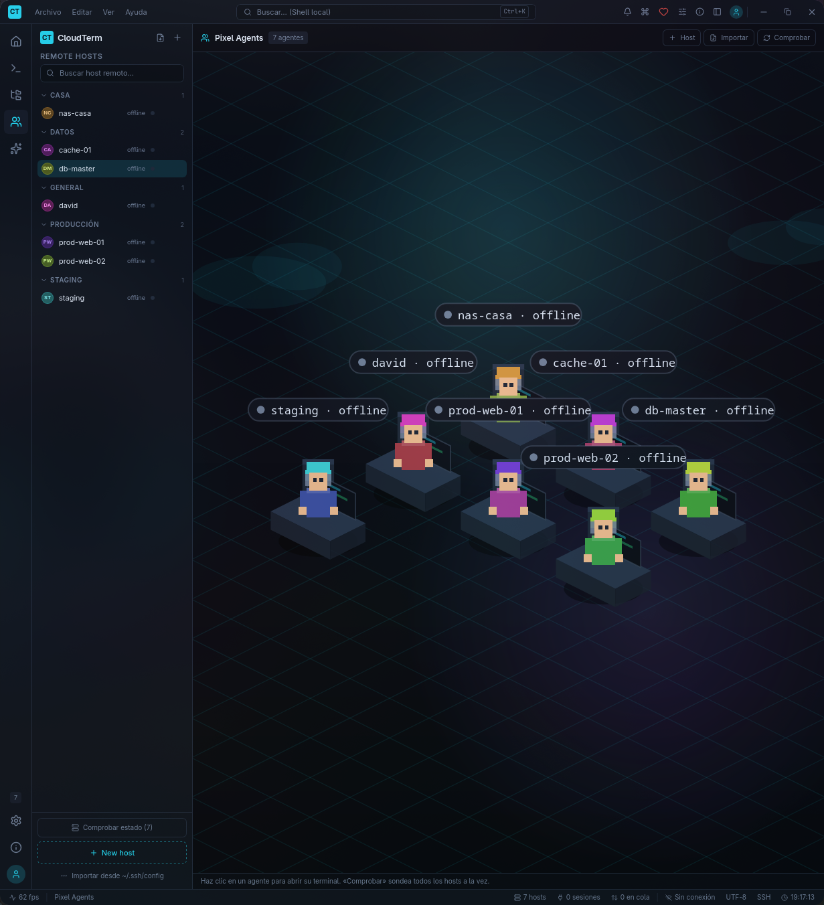

# CloudTerm — Descargas

**CloudTerm** es un cliente SSH/SFTP moderno para **Windows, Linux y Android**: terminal con pestañas, gestor de archivos SFTP, túneles, gestor de claves, snippets, temas, asistente IA y sincronización cifrada de extremo a extremo (Google Drive, Gist u OneDrive) entre escritorio y móvil.

Este repositorio es **solo para descargas**. El código fuente es privado.

## Descargar

**Todas las versiones → [Releases](https://github.com/pilahito/CloudTerm-Releases/releases)**

| Plataforma | Archivo | Enlace |
|---|---|---|
| **Windows** | Instalador (Inno Setup) | [CloudTerm-1.1.0-windows-x64-instalador.exe](https://github.com/pilahito/CloudTerm-Releases/releases/download/desktop-v1.1.0/CloudTerm-1.1.0-windows-x64-instalador.exe) |
| **Windows** | Instalador NSIS x64 | [CloudTerm_1.1.0_x64-setup.exe](https://github.com/pilahito/CloudTerm-Releases/releases/download/desktop-v1.1.0/CloudTerm_1.1.0_x64-setup.exe) |
| **Linux** | .deb (amd64 / arm64) | [amd64](https://github.com/pilahito/CloudTerm-Releases/releases/download/desktop-v1.1.0/CloudTerm_1.1.0_amd64.deb) · [arm64](https://github.com/pilahito/CloudTerm-Releases/releases/download/desktop-v1.1.0/CloudTerm_1.1.0_arm64.deb) |
| **Linux** | AppImage (x86_64 / aarch64) | [x86_64](https://github.com/pilahito/CloudTerm-Releases/releases/download/desktop-v1.1.0/CloudTerm_1.1.0_amd64.AppImage) · [aarch64](https://github.com/pilahito/CloudTerm-Releases/releases/download/desktop-v1.1.0/CloudTerm_1.1.0_aarch64.AppImage) |
| **Android** | APK firmado (Android 8+) | [CloudTerm-android-1.5.1.apk](https://github.com/pilahito/CloudTerm-Releases/releases/download/android-v1.5.1/CloudTerm-android-1.5.1.apk) |

Las etiquetas son `desktop-vX.Y.Z` para escritorio y `android-vX.Y.Z` para Android. Las apps buscan actualizaciones aquí.

## Capturas

| Inicio | Terminal | Pixel Agents |
|---|---|---|
|  |  |  |

## Apoyar CloudTerm

Si CloudTerm te es útil, puedes apoyarlo en **[Ko-fi](https://ko-fi.com/davidmorenorufino)**. Quien apoya recibe un código de Supporter que desbloquea temas extra.

## Licencia

**CloudTerm Source-Available License v1.0** — texto completo en español con traducción al inglés en [`LICENSE`](LICENSE).

- ✅ Puedes descargar, instalar y **usar** CloudTerm gratis, en casa o en el trabajo.
- ❌ Sin permiso previo y por escrito del autor no puedes modificarlo, redistribuirlo, publicarlo en tiendas (Google Play, etc.), venderlo, sublicenciarlo ni ofrecerlo como servicio de pago.
- ❌ El nombre «CloudTerm» y su logo/icono son del autor.
- Las versiones publicadas antes del cambio de licencia siguen bajo AGPL-3.0 para quien las obtuvo.

Contacto y permisos: [github.com/pilahito](https://github.com/pilahito)

© 2026 pilahito (DavidPilahito7)
